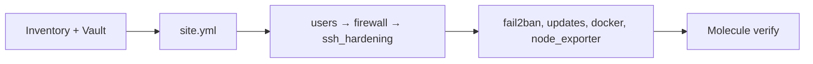

# ansible-linux-baseline

[](https://github.com/nikit0id/ansible-linux-baseline/actions/workflows/ci.yml)

Playbook приводит Ubuntu 24.04 к общей конфигурации оператора, SSH, сетевого фильтра, обновлений, Docker и метрик. Molecule повторно применяет тот же playbook и проверяет работающие службы.



## Запуск за три команды

На Linux нужны Python 3.12 с venv, Git, OpenSSH и Docker с поддержкой systemd в привилегированном тестовом контейнере. Сценарий создаёт одноразовый ключ.

```bash
git clone https://github.com/nikit0id/ansible-linux-baseline && cd ansible-linux-baseline
./scripts/setup
./scripts/test
```

## Что внутри

- В site.yml роли выполняются по одному хосту за раз. Оператор получает sudo и вход по ключу. UFW открывает TCP 22 перед включением фильтра. Публичные порты приложения заданы в group_vars.
- Fail2ban читает журнал SSH. Обновления запускает systemd timer, Docker и Compose устанавливаются из Ubuntu. node_exporter отдаёт host-метрики на 9100. Открывайте этот порт только для адреса вашего Prometheus.
- Для сервера скопируйте hosts.example.yml в hosts.local.yml в выбранном inventory, укажите доступный адрес и пользователя с sudo. Передайте ваш **публичный** ключ через BASELINE_PUBLIC_KEY. Текущую SSH-сессию держите открытой до проверки входа новым оператором.
- Пример запуска из активированной .venv: `ansible-playbook -i inventories/staging/hosts.local.yml site.yml`. При необходимости создайте зашифрованный файл командой `ansible-vault create inventories/staging/group_vars/all/vault.yml`, определите в нём ansible_become_password и запускайте с `--ask-vault-pass`. Пароль Vault хранит оператор. Пример имени переменной есть в vars.example.yml.
- Molecule проверяет повторное применение, фактические параметры sshd, UFW, jail SSH, таймер обновлений, Docker и метрику CPU.

## Что я узнал

- Сначала устанавливается ключ нового оператора и открывается SSH в UFW. Затем можно запретить пароль и вход root.
- sshd -T показывает итоговую политику после чтения всех включаемых файлов. Это проверяет результат применения шаблона.
- Второй converge помогает найти лишний рестарт или файл, который меняется при каждом запуске.

## Что бы сделал дальше

- Подключить отдельную тестовую ВМ для проверки входа по SSH перед тиражированием на несколько серверов.
- Добавить проверку обновления с предыдущей LTS при появлении таких хостов в inventory.
